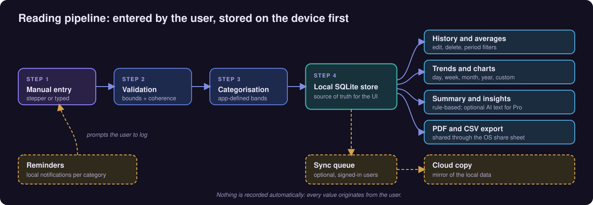
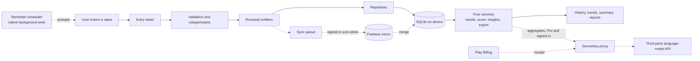

# PulseBP

**A local-first Android logging app for blood pressure and related wellness metrics: the user enters values, the app stores them on the device, and turns them into history, trends, summaries and shareable reports.**

**Android** 
Flutter · Dart · Riverpod · SQLite · Firebase · Serverless proxy

<table>
  <tr>
    <td></td>
    <td></td>
  </tr>
</table>
Real screenshots from the Android build: the "Log a reading" sheet and the Reminders screen.

---

## Get the App

  

The store listing linked here is for Android and is titled "PulseBP: Blood Pressure Log".

## What PulseBP Is and Is Not

PulseBP is a **logging and tracking tool**. The person using it types in values read from their own devices, and the app keeps, organises and summarises what they entered.

- It **does not measure** blood pressure or anything else. It has no Bluetooth, camera or sensor integration and no health-platform integration. The log sheet itself says that every reading is entered by the user and nothing is recorded automatically.
- It is **not a medical device**. It does not diagnose or treat any condition and does not replace professional medical advice. The app's own privacy text says so in a callout at the top, and its summaries, its Heart Score explanation and every exported PDF page carry a similar not-medical-advice line.
- Reading categories are the app's **own fixed bands**, not a clinical assessment. The Heart Score is an app-defined summary of logged data, not a risk score.
- AI summaries, when enabled, are text generated from aggregated logged data and are informational only.

This repository describes the **software engineering** of the app. It makes no statements about health outcomes.

## Product at a Glance

| | |
|---|---|
| **What it is** | A manual-entry log for blood pressure plus blood sugar, weight, SpO2 (entered by hand), sleep, calories and meals, hydration and medication |
| **Core loop** | Enter a value, check it, store it locally, then see history, averages, charts, a summary and reports |
| **Reminders** | Local notifications per category, and medication schedules with taken/skipped tracking |
| **Reports** | PDF and CSV export through the system share sheet |
| **Accounts** | Guest by default; optional sign-in (Google or Apple) with cloud backup and sync |
| **Tiers** | Free with ads and a limited history window; a Pro subscription via native billing unlocks more, including optional AI summaries |
| **Platform** | Android (Flutter) |
| **Code size** | About 56k lines of Dart across roughly 245 files in the app source (generated localisation output excluded), counted with line counts |
| **Languages** | 15 UI locales including right-to-left layouts |

## Live Product Showcase

The gallery shows the entry, reminders and paywall flows and the splash screen. No screenshot shows a populated reading, trend or history screen, so none are described here; those behaviours are documented in text from the production code.

<table>
  <tr>
    <td align="center"> <b>Log a reading</b> Eight metric types, manual entry</td>
    <td align="center"> <b>Reminders</b> One card per category (empty state)</td>
  </tr>
  <tr>
    <td align="center"> <b>Pro paywall</b> Heading and summary line (cropped, no prices)</td>
    <td align="center"> <b>Splash</b> Branded start-up screen</td>
  </tr>
</table>

Real screenshots from the Android build, cropped to the app content (system status bar and ad-placeholder strips removed), captured with sample/placeholder data, metadata removed.

## How a Reading Flows

  

Everything the UI shows is read from the local database. Cloud sync, when the user is signed in, mirrors that data rather than owning it. Reminders only prompt the user to open the app and log.

## Engineering Highlights

### Offline-first sync without a custom API server
- **Problem:** people log on a phone that is often offline and may use more than one device, but the product has no bespoke backend for user data.
- **Approach:** SQLite is the system of record. Each create, update or delete writes locally and appends a durable operation to a queue. A sync manager pushes the queue, pulls remote changes, scans for unsynced local rows and retries with exponential backoff. Conflicts resolve by last-updated-wins with soft-delete markers, and a guard flag stops inbound changes from re-queueing themselves.
- **Outcome:** logging works with no connectivity, and sync is an optional layer that does not sit in the entry path.

### Server-side checks in front of a paid AI feature
- **Problem:** a client-side "Pro" flag cannot protect a feature that costs money to serve.
- **Approach:** a serverless proxy sits between the app and a third-party language-model API. It verifies the caller's sign-in token and a stored purchase entitlement (set by a separate receipt-verification call), applies per-user usage limits, caches repeat requests, checks the model's JSON output against a schema, and keeps the API key out of the app. The app sends locally computed aggregates and profile context (including medication names and doses and a free-text goal) rather than raw reading rows. The data is not anonymous.
- **Outcome:** AI summaries are optional, gated and bounded, with a free rule-based insights engine as the default.

### Reminders without exact-alarm permission
- **Problem:** exact alarms need extra permissions and review friction, yet reminders must survive reboots and app updates.
- **Approach:** native background-work scheduling reached through a platform channel, exact-alarm permissions stripped from the build, reliance on the background-work library to persist scheduled work, resynchronising every schedule on each launch, and a rule that suppresses duplicate generic medication reminders once at least one medication has been added.
- **Outcome:** fewer permissions. The trade-off is that the system may shift delivery under battery optimisation.

### More
| Area | What was built |
|---|---|
| **Entry validation** | Bounded steppers and typed values rejected in place with a range message, a save-time adjustment that keeps the lower pressure value below the upper, and timestamps clamped so they cannot be in the future |
| **Domain core** | Pure, deterministic services for trends, adherence, a composite score, rule-based insights and report building, taking an explicit "now" for testability |
| **Medication engine** | Daily, weekday and course schedules generate idempotent dose records over a rolling window, feeding reminders and adherence |
| **Start-up** | Native splash, an immediately painted matching first frame, and non-essential SDK work deferred until after it |
| **Monetisation** | Native subscription billing, a free tier with ads and a history window, remote controls that default ads off until confirmed |
| **Observability** | Analytics events kept free of free text by convention, crash reporting and performance traces |
| **Tests** | About 90 test files covering logging, database, sync, auth, billing gates, reminders, medication, scoring, trends, insights, export and layout |

Details and trade-offs: [docs/ENGINEERING_CHALLENGES.md](docs/ENGINEERING_CHALLENGES.md).

## Architecture

More diagrams and component responsibilities: [docs/ARCHITECTURE.md](docs/ARCHITECTURE.md).

## Technology Stack

| Layer | Technology |
|---|---|
| App framework | Flutter / Dart 3 |
| State management | Riverpod |
| Local storage | SQLite (schema-versioned, migrated in place), shared preferences for small settings |
| Charts and reports | Charting library for trends; PDF generation and CSV export through the share sheet |
| Notifications | Local notifications plus native Android background work via a platform channel; push messaging |
| Backend services | Firebase Auth, Cloud Firestore, Analytics, Crashlytics, Performance, Messaging |
| Sign-in | Google or Apple; the guest account is linked on sign-in so local data is kept |
| Billing | Native in-app subscriptions through Play Billing |
| Ads | Ad-mediation SDK with AdMob among the networks, consent flow, free tier only |
| AI summaries | Serverless proxy (TypeScript, Cloudflare Workers) relaying aggregates to a third-party language-model API |
| Native layer | Kotlin for splash, notifications and messaging |
| Localisation | 15 locales via generated localisation classes, with right-to-left support |

## Project Scope

PulseBP is a production Android application. This portfolio focuses on the engineering: a local-first data layer, a durable sync design, reminders, a gated AI path and a freemium model, built in one Flutter codebase.

## Documentation

| Read | For |
|---|---|
| [Product overview](docs/PRODUCT_OVERVIEW.md) | What the app does, what it is not, and what each screen shows |
| [Technical case study](docs/TECHNICAL_CASE_STUDY.md) | End-to-end technical write-up |
| [Architecture](docs/ARCHITECTURE.md) | Diagrams and component responsibilities |
| [Engineering challenges](docs/ENGINEERING_CHALLENGES.md) | Problem, approach, trade-offs, outcome |
| [Privacy and source](docs/PRIVACY_AND_SOURCE.md) | What is and is not published, and data-handling notes |

## Source Code

This repository is a portfolio showcase for a production application. Production source code is maintained privately. See [RIGHTS.md](RIGHTS.md) for usage terms.
