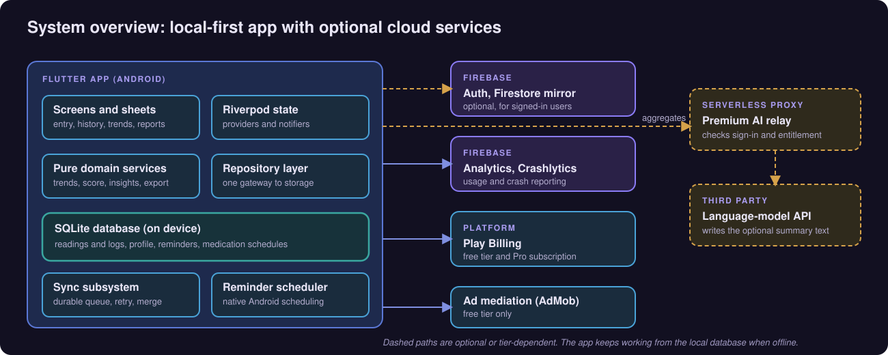
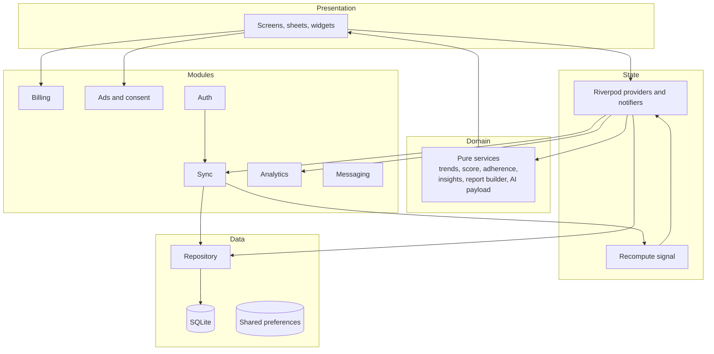
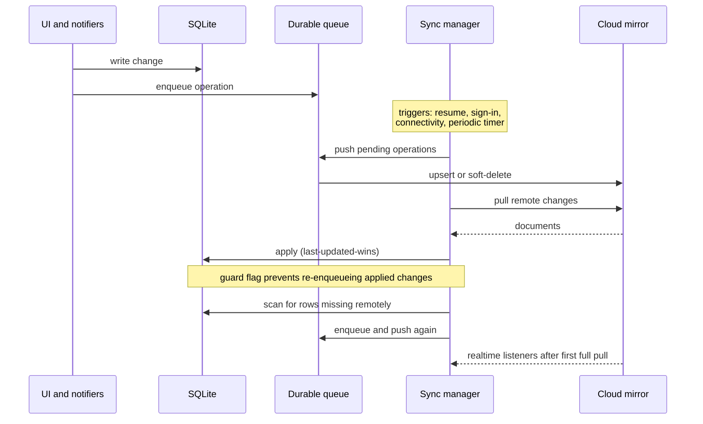
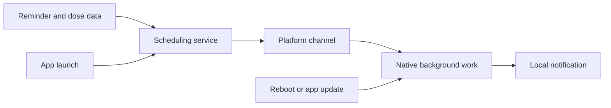
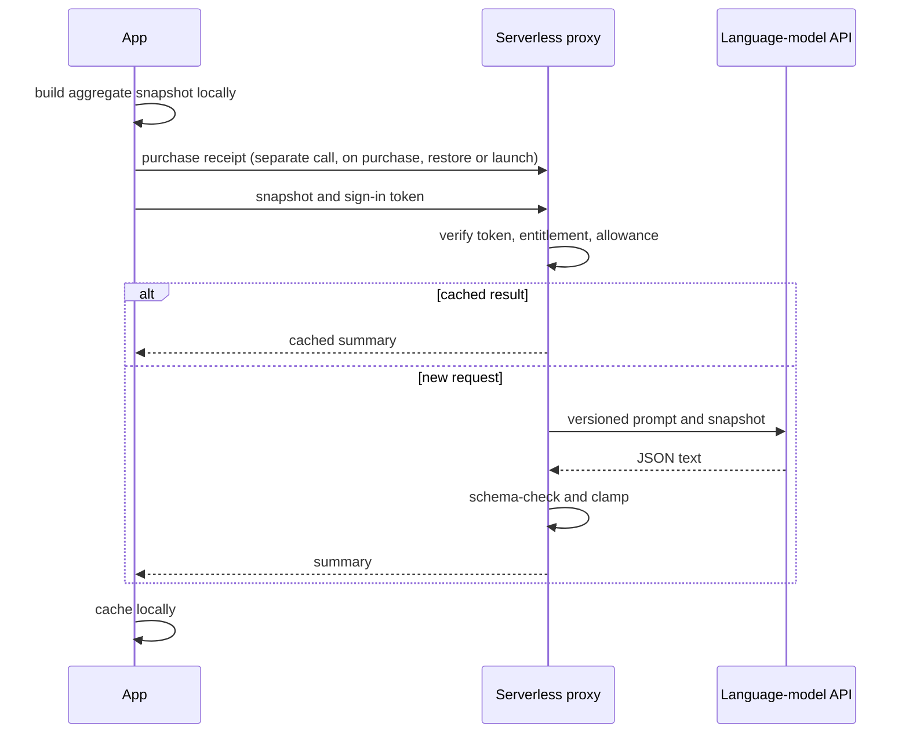

# Architecture

Diagram labels are conceptual and do not correspond to production identifiers.

## System overview

  

PulseBP is one Flutter codebase, currently listed on Google Play. The device holds the data and does the computing. Remote services are additive: a Firebase mirror for signed-in users, analytics and crash reporting, store billing, ads for the free tier, and a small serverless proxy that exists only for the optional premium AI summary.

## Reading pipeline

  

A value begins with the user. It is checked against bounds, assigned an app-defined category, and written to SQLite. Every output (history, averages, charts, summaries, exports) is derived from the local store. Reminders and sync are side paths: reminders prompt the user to log, and sync mirrors data when the user is signed in.

## Layers

| Layer | Responsibility |
|---|---|
| **Presentation** | Renders state and opens modal sheets for entry and detail. A small phase machine swaps the top-level stage (loading, language, onboarding, setup, app); the main shell holds six tabs. |
| **State** | Notifiers own mutable state and orchestrate repository calls. A single recompute signal invalidates derived providers whether a change came from the user or from sync. |
| **Domain** | Pure services with no I/O: trend bucketing, the composite score, adherence, rule-based insights, report assembly and the AI snapshot builder. They take an explicit current time. |
| **Data** | One repository over a schema-versioned SQLite helper. Small settings use shared preferences. |
| **Modules** | Cross-cutting concerns kept out of the screens: sync, billing, ads and consent, analytics, auth and messaging. |

## Local data model

One SQLite database holds a table per metric (blood pressure, blood sugar, weight, SpO2, sleep, meals, hydration), plus the profile, reminders, medication definitions, medication schedules and generated dose events. Migrations are additive and idempotent. Dose events are unique per medication and scheduled time, which makes regeneration of the rolling window safe to repeat. Timestamps for readings are stored as local wall-clock values; the sync payload adds UTC created and updated times.

## Sync

Responsibilities: the queue persists operations across restarts; the manager sequences push, pull, scan and push with backoff and retry classification; mappers translate rows to documents; a pull applier merges by last-updated and applies soft-delete markers; realtime listeners pause during a cycle and are debounced. Cloud documents live under a per-user path guarded by owner-only security rules.

## Reminder scheduling

The scheduling service decides what should exist (generic reminders, plus one-shot dose events from medication schedules, with duplicates suppressed). A platform channel hands the work to native Android scheduling. The platform's background-work library persists scheduled work across reboot and update, and the app resyncs all schedules on every launch.

## Premium AI path

The proxy is deliberately thin: it authenticates, authorises, rate-limits, caches and checks output. It stores no reading rows; it keeps per-user allowance counters, an entitlement record, and a time-limited cache of generated summary text. The model's key never ships in the app.

## Monetisation modules

- **Billing** wraps native subscriptions: product lookup, purchase stream, restore, and forwarding of the signed receipt to the proxy for the AI feature.
- **Pro gate** is one central check consulted by screens. Locked features record analytics with the trigger that opened the paywall.
- **Ads** are requested only with consent, only for free users, and only when a remote per-placement switch is true. Switches default to off. Several formats share cooldowns so ads cannot stack.
- **Rewarded unlocks** grant temporary access (for example to export) and persist across restarts.

## Component map

| Concern | Where it lives conceptually |
|---|---|
| Entry and validation | Entry sheet and the notifier that clamps and normalises on save |
| Categorisation | A single function on the reading model |
| Trends and averages | Pure trends service plus a provider |
| Heart Score | Pure score service plus a provider |
| Insights | Pure local insights engine |
| Reports | Pure report service, PDF and CSV builders, share sheet |
| Sync | Dedicated module with queue, manager, mappers, applier, listeners |
| Auth | Repository and provider over Firebase Auth |
| Notifications | Scheduling service, platform channel, native Android code |
| AI client | Service that builds the snapshot and talks to the proxy |
