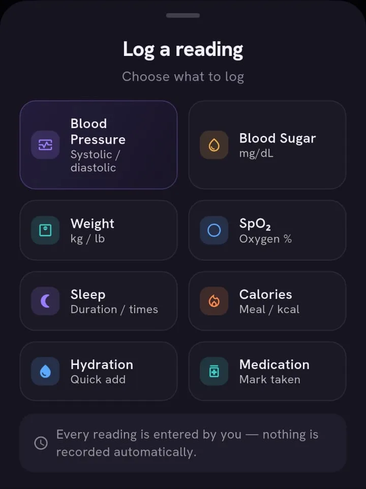
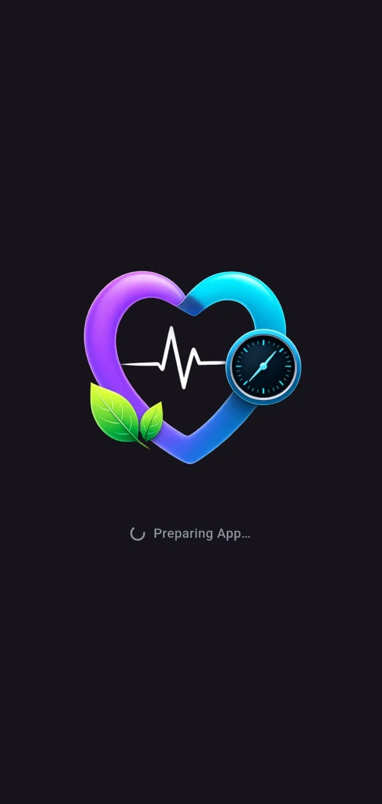
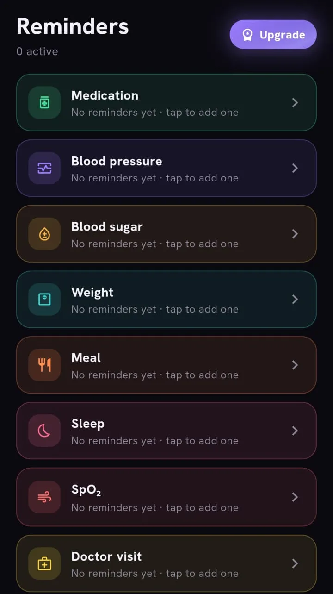
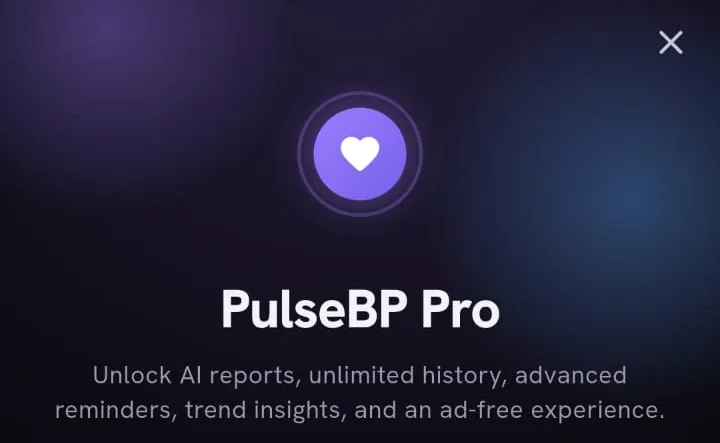

# Product Overview

All screenshots on this page are real captures from the Android build, cropped to the app content (system status bar and ad-placeholder strips removed), captured with sample/placeholder data, metadata removed. The app is listed on [Google Play](https://play.google.com/store/apps/details?id=co.futurewatch.pulsebp&hl=en-US&ah=mBXrEU8bEbhs9Y9EvB-M12DD6WU) as "PulseBP: Blood Pressure Log". The store listing linked here is for Android.

The screenshot set covers the entry, reminders and paywall flows and the splash screen. It does not include screens with populated readings, charts or history, so this page describes those areas in words only, based on the production code, and shows no pictures of them.

## What PulseBP is and is not

PulseBP is a **logging and tracking tool**. Someone with a home monitor, a scale or a glucose meter reads a value from that device and types it into the app. The app stores it, organises it by time and metric, and presents it back as history, averages, charts, a summary and a report.

What it is not matters just as much:

- **It does not measure anything.** There is no Bluetooth, camera or sensor integration and no health-platform integration. The "Log a reading" sheet states that every reading is entered by the user and nothing is recorded automatically.
- **It is not a medical device.** The in-app privacy text opens with a callout saying it is a personal wellness and tracking tool, does not measure any reading itself, does not diagnose, treat, cure or prevent any disease, and is not a substitute for professional medical advice. Summaries, the Heart Score explanation and every exported PDF page carry a similar not-medical-advice line.
- **Its categories are the app's own.** Blood pressure values fall into five labelled bands defined by fixed thresholds inside the app. They are a display convenience, not an assessment, and this repository does not attribute them to any guideline.
- **The Heart Score is an app-defined summary.** It combines whichever logged metrics have data in a recent window into one number. It is not a risk score, and the app says it is not a diagnosis.
- **AI summaries are informational.** They are optional, generated from aggregated logged data, and the model is instructed to avoid diagnosing and not to recommend starting, stopping or changing prescription medication without clinician guidance.

If a reader has a health concern, the right place for it is a qualified professional, not a log.

## Metrics the app can log

<table>
  <tr>
    <td align="center"> The "Log a reading" sheet</td>
  </tr>
</table>

The sheet offers eight types, with blood pressure as the highlighted primary card:

| Type | How it is entered |
|---|---|
| Blood pressure | Two values (upper and lower) via steppers or typed input, a date and time, and optional context tags |
| Blood sugar | A single value in mg/dL |
| Weight | kg or lb |
| SpO2 | A percentage typed in by the user; the app has no sensor |
| Sleep | Duration or bed and wake times, plus a quality choice |
| Calories | Meals with a calorie value |
| Hydration | Quick-add amounts toward a daily goal |
| Medication | Mark a scheduled dose as taken or skipped |

Entry is bounded: steppers stop at plausible limits, typed values outside the allowed range are rejected with a message instead of being silently changed, and a reading cannot be dated in the future.

## First run and profile

<table>
  <tr>
    <td align="center"> Splash</td>
  </tr>
</table>

A native splash appears instantly, followed by a matching first frame from Flutter. The first launch offers a language choice from 15 locales, then a short carousel and a six-step guided setup covering basic profile details, units, optional conditions and a goal. No screenshots of the onboarding or setup screens are included here.

The profile is stored locally. In the production code its main downstream use is as context for the optional AI summary; reading categories do not change with it.

## Reminders and medications

<table>
  <tr>
    <td align="center"> Reminders by category (empty state)</td>
  </tr>
</table>

Reminders are organised by category (medication, blood pressure, blood sugar, weight, meal, sleep, SpO2 and doctor visits appear in the capture). Each reminder has a title, a time and an on/off switch, and is delivered as a local notification. Medication entries are richer: a medication has a name, a free-text dose and a schedule (daily, chosen weekdays, or a course with an end), from which the app generates dose events for a rolling window. Marking events taken or skipped drives an adherence figure. Once at least one medication has been added, generic medication reminders are suppressed so the user does not get duplicates.

On a free account the number of reminders is capped and the medications sheet is locked; the Pro tier removes those limits.

## History, trends, summary and reports

These areas have no screenshots in this repository, so only their behaviour is described.

- **History.** Entries can be opened, edited and deleted. Free users see a short rolling window of recent data; Pro users see everything. Older rows are not discarded.
- **Trends.** Day, week, month, year and custom ranges, with a two-line chart for blood pressure and secondary trends for other metrics. Averages, minimum and maximum come from the raw samples in the range, and direction is a simple first-versus-last comparison.
- **Summary.** A weekly summary assembled by deterministic, rule-based logic, with minimum-data thresholds before it says anything about a trend. Some content is locked for free users unless they watch a rewarded ad or subscribe.
- **Optional AI summary.** For signed-in Pro users, a button generates a short written analysis. See [the technical case study](TECHNICAL_CASE_STUDY.md) for how the request is bounded.
- **Reports.** A PDF and a CSV can be produced for a chosen period and shared through the system share sheet. Every PDF page carries a not-medical-advice footer. Free users unlock export temporarily by watching a rewarded ad.

## Accounts, tiers and the paywall

<table>
  <tr>
    <td align="center"> Pro paywall: heading and summary line (cropped, no prices)</td>
  </tr>
</table>

The user starts as a guest. Signing in with Google or Apple links that guest to an account, keeps the local data and enables cloud backup and sync. Sync is available to any signed-in user.

The free tier is supported by ads and has a history window, a reminder cap and gated extras. The Pro subscription, bought through the store's native billing flow, lifts those limits, removes ads and enables the optional AI summary. The paywall lists the benefits, offers two billing periods with prices read from the store, and includes a restore-purchases action. The capture here is cropped to the title and benefits list, and no prices are given in this repository.

## Preferences and accessibility options

Settings include language, dark or light theme, units, haptics, sound effects, large text, high contrast and reduce-motion options, notification checks, the privacy policy and terms. These are in-app options; this repository makes no claim of formal accessibility conformance.
